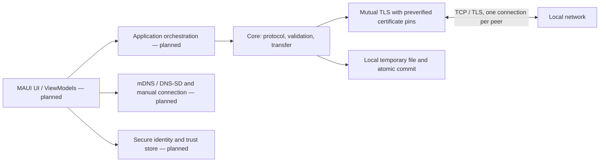
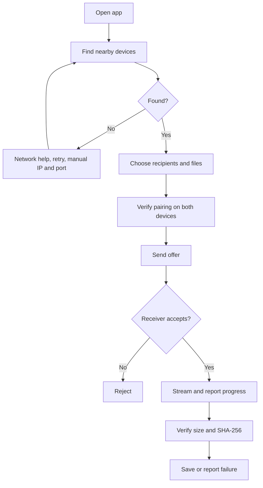

# Architecture and scope

Status: **core prototype only, not a working application or MVP**. This repository does not yet contain a MAUI application, platform adapters, discovery, pairing UI, persistence, history, orchestration, or installer. No claim is made that any platform combination works. The following diagram distinguishes implemented components from the intended application.

The standalone `HamResan.Core` library implements only the solid boxes above. It supports one offer per authenticated connection and sequential files. Callers are responsible for listening, picking peers, setting up verified pins and certificates, user approval, timeouts, cancellation, error presentation, and concurrency limits. There is no automatic receiving. Multiple connections can run independently but this has not been integrated or tested as multi-send. Destination is a local directory and is **not** an Android public storage adapter.

.NET 10 is the current LTS line; `global.json` requests 10.0.100, allows newer stable feature bands in the same major/minor line, and excludes previews. This is a selection for the portable library, not evidence of an installed compatible MAUI workload. MAUI and its platform workload versions must be verified on the actual Windows build machine. The core uses only the BCL; the test harness uses no NuGet packages. The CI workflow uses GitHub-maintained checkout and setup-dotnet actions; these actions and SDK are external development tooling, not application dependencies.

## Target user flow (not yet implemented)

The diagram describes the goal, not delivered functionality. In particular, first-time pairing and trust persistence are absent; no claim of auto-accept support is made.
