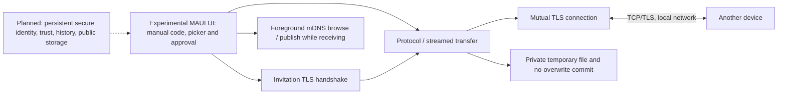
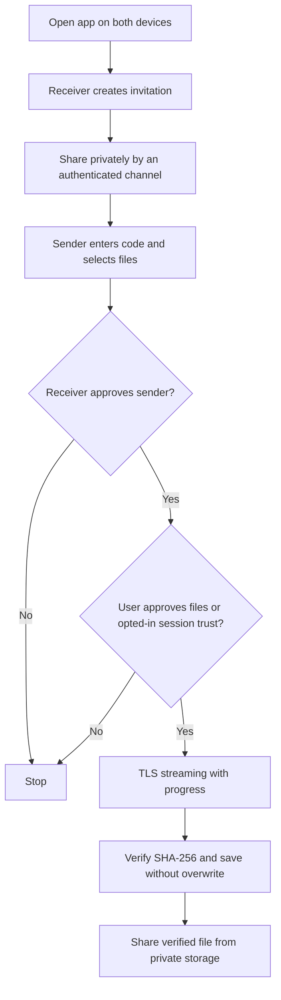

# Architecture and scope

The repository has an experimental foreground-only MAUI screen and a portable core, not a complete MVP. On each app start/session, the UI creates an ephemeral certificate. The receiver listens on a selected local IPv4 address, shares a long one-use invitation out of band, approves an unknown sender and, unless the user explicitly opts that certificate into session-only automatic reception, separately approves each file offer. The sender stages picker files in private cache, then sends over the authenticated connection. The receiver stores verified files in private app storage and can invoke the system share sheet. Real Android/Windows operation is not yet verified.

mDNS browsing runs while the app is foreground; a receiver advertises only while waiting. Discovery is informational and does not replace invitation authentication. Opt-in auto reception is limited to explicitly approved certificate fingerprints in memory for the current session. No concurrent multi-recipient orchestration, persisted trust, history, or background service exists. One operation is permitted at a time in the UI. IP discovery is only local interface enumeration and users must choose an appropriate address. No automatic firewall changes occur. The application's MAUI code-behind is provisional, not the requested MVVM/localized architecture.

.NET 10 is the selected LTS line; `global.json` requests 10.0.100 with later stable feature bands in the same major/minor allowed. The core depends only on the .NET BCL, the UI uses Microsoft.Maui.Controls. CI uses GitHub-maintained checkout/setup-dotnet/upload-artifact actions and Inno Setup for the Windows installer. Actual MAUI compatibility and build must be assessed from the workflow result, not assumed.

## Current and target flow

## Scope additions requested

An experimental iOS simulator target and build workflow exist; no signed installable iPhone build, real-device verification, or conversion engine exists. Files are streamed unchanged, so compatibility with an arbitrary app or OS is not guaranteed. Universal lossless conversion of all file types is impossible; future per-format conversion must be opt-in, preserve originals, disclose metadata and quality implications, and explicitly report unsupported formats. mDNS is link-local, not a way to traverse arbitrary VPNs or isolated networks; direct IP works only if routing/firewall policy permits it. The sender may override the destination IP while keeping the invitation port, certificate pin and secret unchanged. No relay or Internet service is present.
