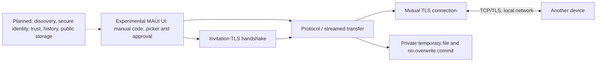
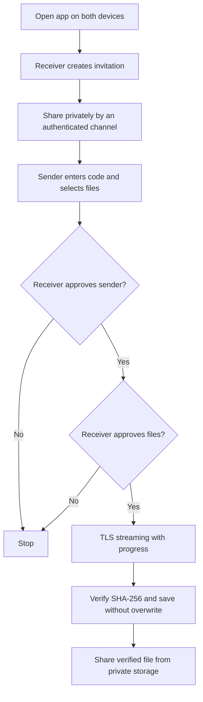

# Architecture and scope

The repository has an experimental foreground-only MAUI screen and a portable core, not a complete MVP. On each app start/session, the UI creates an ephemeral certificate. The receiver listens on a selected local IPv4 address, shares a long one-use invitation out of band, approves the sender, and separately approves the file offer. The sender stages picker files in private cache, then sends over the authenticated connection. The receiver stores verified files in private app storage and can invoke the system share sheet. Real Android/Windows operation is not yet verified.

No mDNS, concurrent multi-recipient orchestration, persisted trust, history, or background service exists. One operation is permitted at a time in the UI. IP discovery is only local interface enumeration and users must choose an appropriate address. No automatic firewall changes occur. The application's MAUI code-behind is provisional, not the requested MVVM/localized architecture.

.NET 10 is the selected LTS line; `global.json` requests 10.0.100 with later stable feature bands in the same major/minor allowed. The core depends only on the .NET BCL, the UI uses Microsoft.Maui.Controls. CI uses GitHub-maintained checkout/setup-dotnet/upload-artifact actions and Inno Setup for the Windows installer. Actual MAUI compatibility and build must be assessed from the workflow result, not assumed.

## Current and target flow

