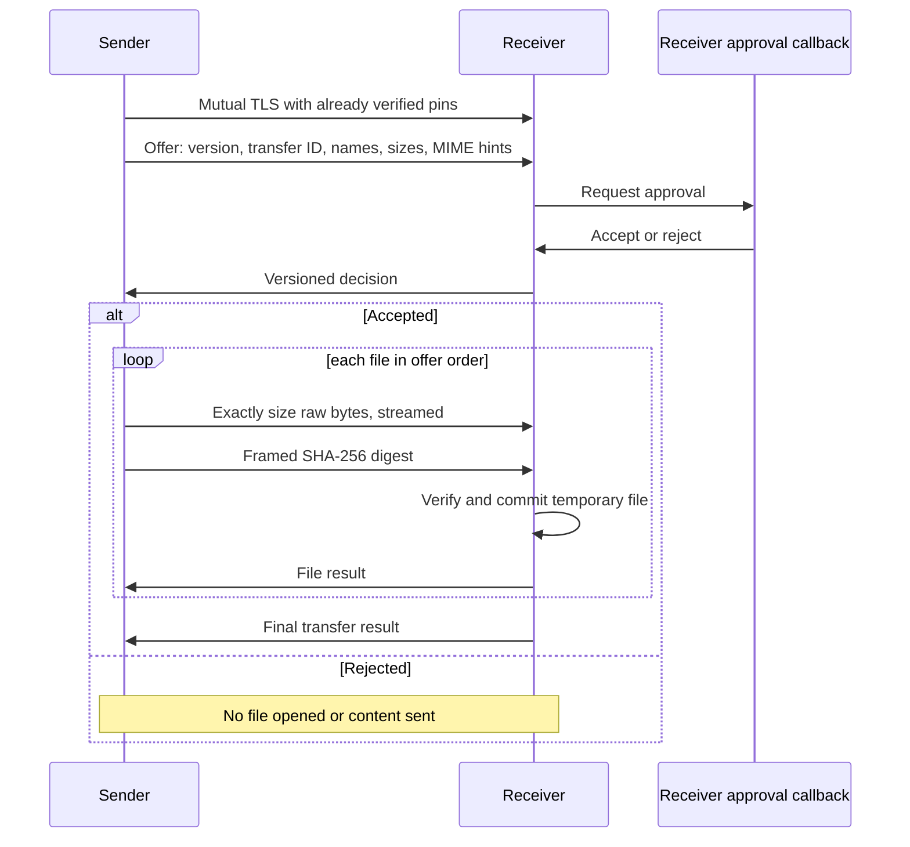

# Protocol v1 (core prototype)

All application data requires a `PinnedConnection`, created after mutual TLS with explicit, independently verified SHA-256 certificate fingerprints. JSON controls use four-byte unsigned-equivalent big-endian lengths, restricted to 1–1,048,576 bytes, followed by UTF-8 JSON. No compression. A single connection carries one offer. The app advertises and browses `_hamresan._tcp.local` using mDNS separately; discovery is not a trust or transfer protocol.

Names are untrusted basenames; path separators and traversal are rejected, unsafe Windows characters replaced, and device names escaped. A maximum of 128 files is accepted, sizes are nonnegative signed 64-bit integers, sums are overflow-checked and subject to a caller-selected total limit. MIME is only a hint. Progress is per file in bytes and elapsed time; The experimental UI derives an approximate speed and ETA from these values. Data is copied with a 256 KiB pooled buffer and SHA-256 is computed incrementally. Finalization uses a same-directory non-overwriting move; collision suffixes are attempted atomically. Some files may already have committed if a later file fails; no batch rollback is promised. A lost acknowledgement may leave a verified received file although the sender reports failure.

Cancellation and deadlines are local cancellation tokens, not a separate on-wire cancel frame; the caller must dispose the connection on failure/cancellation so the peer observes termination. There is no resume. There is no startup cleanup for partial files left by process termination. The temporary directory must be private to the application; cleanup on ordinary exceptions is best effort and filesystem errors can prevent it. Disk space/permission and network failures propagate to the caller. The receiver's destination must be on a filesystem supporting the documented move semantics.

The experimental invitation bootstrap is implemented separately by `InvitationPairing`. The client first pins the server certificate from the invitation, then sends the one-use secret and a claimed display name over TLS. The receiver consumes the secret and explicitly asks its user before returning the authenticated session. The receiver separately approves the file offer by default; only a fingerprint explicitly opted into session auto-reception can bypass that prompt. This is ephemeral, not stored peer trust; see SECURITY.md for assumptions and limitations.

A sender may locally replace only the target IP in an invitation to use another routed interface. The receiver certificate pin, port and bearer secret remain unchanged. This does not provide relaying or guarantee reachability.
